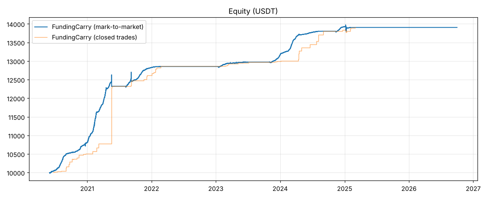
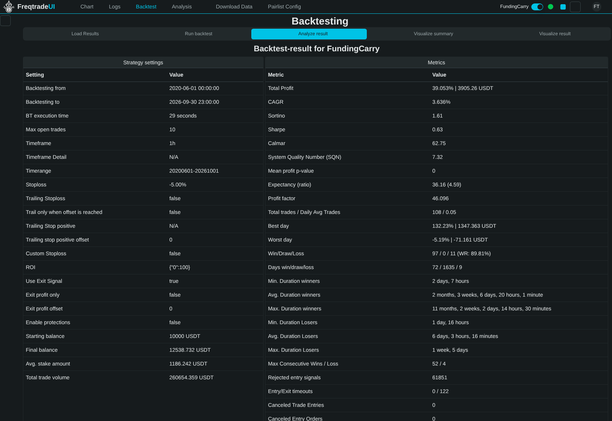
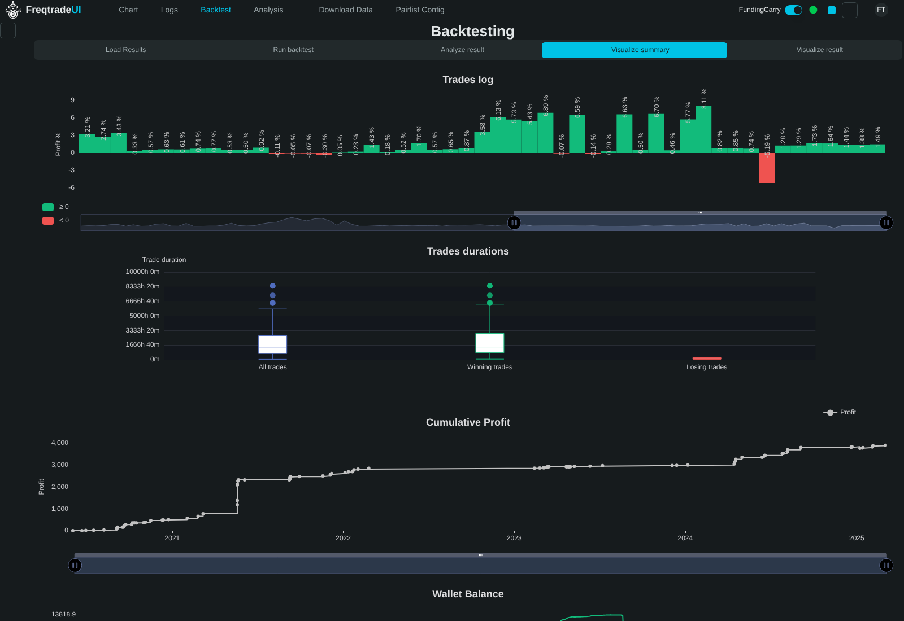

# 加密貨幣多幣輪動策略研究（Freqtrade + FreqUI）

以 **Freqtrade** 回測、**FreqUI** 視覺化的加密貨幣策略研究專案。目標條件：

| 目標 | 要求 |
|---|---|
| 市場 | 加密貨幣（Binance 現貨 / USDT 永續） |
| 多幣池輪動 | ✅ 必須支援 |
| 最大回撤 MDD | < 15 % |
| 勝率 | > 60 % |
| 獲利曲線 | 平滑 |
| 過擬合 | 必須避免 |

## 結論（最終策略：`FundingCarry` 資金費率套利 + 多幣輪動）

Delta 中性（現貨做多 + 永續做空，1 倍對沖），把資金輪動到「目前資金費率最高」的幣種，
資金費率轉負就退出。全部回測使用 Binance 真實歷史資料（含已下市幣種）。

| 測試 | 期間 / 幣池 | 交易數 | 勝率 | 總報酬 | MDD（已平倉 / 逐時市值） | 月份為正 |
|---|---|---|---|---|---|---|
| In-sample（設計用） | 2020-06 → 2023-12，幣池 A | 87 | **90.8 %** | +30.8 % | 0.1 % / 2.6 % | 95.8 % |
| Out-of-sample（凍結後首次） | 2024-01 → 2026-09，幣池 A | 28 | **82.1 %** | +5.2 % | 0.5 % / 1.3 % | 81.8 % |
| Holdout（**從未見過的 49 個幣**） | 2020-06 → 2026-09，幣池 B | 133 | **83.5 %** | +44.8 % | 1.0 % / 5.1 % | 81.0 % |
| 全期間 | 2020-06 → 2026-09，幣池 A | 108 | **89.8 %** | +39.1 % | 0.5 % / 2.6 % | 94.1 % |
| 全期間、手續費 ×2 | 同上 | 108 | 83.3 % | +36.2 % | 0.5 % / 2.8 % | 91.2 % |

Monte Carlo（5,000 次重抽）：MDD 第 99 百分位 1.0 %、P(勝率 > 60 %) = 100 %、P(報酬 > 0) = 100 %。



**必須知道的限制**：報酬來自市場的資金費率水位。2025-03 之後資金費率長期低於進場門檻，策略
大部分時間空倉（2025 +0.5 %、2026 +0.0 %）——曲線平滑、不虧，但也幾乎不賺。完整說明、
研究歷程（包含失敗的方向性策略）、風險與實盤注意事項請見
**[docs/STRATEGY_REPORT.md](docs/STRATEGY_REPORT.md)**。

> 多空策略研究（目標年化 ≥ 15%）：在乾淨的跨幣池驗證中未達標，完整過程與數字見 [docs/LONG_SHORT_REPORT.md](docs/LONG_SHORT_REPORT.md)。
>
> 指標數據研究（價格行為、諧波形態、技術指標、市場情緒，共 480 個檢定）：沒有特徵通過跨期跨幣池重現與成本檢驗，見 [docs/FEATURE_RESEARCH.md](docs/FEATURE_RESEARCH.md)。
>
> **更好的套利：幣本位季度合約期現套利（BTC/ETH）**——全期間年化 9.1%、樣本外 9.6%、勝率 100%（FundingCarry 為 5.3% / 1.8%）；期權套利（平價、盒式、價差、蝴蝶、日曆、合成遠期 vs 季度期貨）扣資金成本後皆無法規模化。見 [docs/ARBITRAGE_RESEARCH.md](docs/ARBITRAGE_RESEARCH.md)，Freqtrade 策略 `BasisCarry`。小資金（約 100 萬台幣）可做全部 14 個幣：全期間年化 9.0%、樣本外 11.3%、勝率 100%，每日操作工具 `scripts/basis_scanner.py`。
>
> 新幣狙擊（CEX 上市即買）、做空新上市永續、小幣資金費率套利（含 888 個新上市永續與已下市幣，事先登錄假設）：皆未通過樣本外／holdout，見 [docs/LISTING_SMALLCAP_RESEARCH.md](docs/LISTING_SMALLCAP_RESEARCH.md)。

## 目錄

```
configs/                    Freqtrade 設定檔與幣池清單
  config_carry.json           FundingCarry（幣池 A）
  config_carry_holdout_b.json FundingCarry（幣池 B，holdout）
  config_backtest.json        方向性策略 RotationDip（現貨）
  pairs_universe.json         幣池 A：50 個幣（含 EOS/FTM/MATIC/WAVES 等已下市/遷移幣）
  pairs_holdout_b.json        幣池 B：另 50 個幣，最終驗證前完全未使用
user_data/strategies/
  FundingCarry.py           ★ 最終策略：資金費率套利 + 輪動
  RotationDip.py              方向性輪動抄底策略（研究用，OOS 未達標，不建議實盤）
scripts/
  download_binance_data.py  從 Binance 官方歷史資料庫下載 K 線 / 標記價格 / 資金費率
  build_carry_data.py       產生合成套利標的 <COIN>CARRY/USDT
  ft_offline.py             交易所 API 無法連線時執行 freqtrade 的包裝器
  reproduce.sh              一鍵重現所有結果
research/
  analyze.py                指標彙整（含逐時市值回撤重建）
  sensitivity.py            參數敏感度（逐一擾動）
  monte_carlo.py            交易順序重抽
  pit_check.py              全幣池時間點（前視偏差）檢查
  signal_lab.py, carry_lab.py 策略發想用的向量化實驗室
  results/                  所有結果檔（含可載入 FreqUI 的 carry_full.zip）
  archive/                  被淘汰的策略版本（保留以供稽核）
docs/STRATEGY_REPORT.md     完整研究報告
```

## 快速開始

```bash
python3 -m venv .venv && . .venv/bin/activate
pip install freqtrade matplotlib

# 1) 下載資料（Binance 官方 data.binance.vision；不需要 API key）
python scripts/download_binance_data.py --pairs-file configs/pairs_universe.json --timeframes 1h 1d --start 2019-09 --end 2026-09
python scripts/download_binance_data.py --market futures --pairs-file configs/pairs_universe_futures.json --timeframes 1h 1d --start 2019-09 --end 2026-09

# 2) 建立合成套利標的
python scripts/build_carry_data.py --pairs-file configs/pairs_universe.json --out-pairs configs/pairs_carry.json

# 3) 回測（可連到 Binance API 的環境可直接用 `freqtrade` 取代 `python scripts/ft_offline.py`）
python scripts/ft_offline.py backtesting -c configs/config_carry.json --userdir user_data \
    --strategy FundingCarry --timerange 20200601-20261001 --export trades
python research/analyze.py --plot equity.png

# 全部重現（資料下載 + 所有測試）
bash scripts/reproduce.sh
```

### FreqUI

```bash
freqtrade install-ui        # 或從 https://github.com/freqtrade/frequi/releases 下載 freqUI.zip
python scripts/ft_offline.py webserver -c configs/config_carry.json --userdir user_data
# 瀏覽器開 http://127.0.0.1:8080 → 帳號 freqtrader / 密碼 change-me（請在 config 中修改）
# Backtest → Load Results → 選擇結果 → Analyze result / Visualize summary
```

| Analyze result | Visualize summary |
|---|---|
|  |  |

> FreqUI 顯示的 CAGR / Final balance 會偏低：回測期間 FTM 遷移到 Sonic 而停止交易，Freqtrade 的
> 錢包紀錄在幣種資料中斷後遺失該筆部位的本金（交易本身已正確平倉並計入總報酬 +39.05 %）。
> 本專案的 `research/analyze.py` 以交易清單與 K 線獨立重建逐時市值曲線來計算 MDD。

## 免責聲明

本專案僅供研究與教育用途，不構成投資建議。回測結果不代表未來績效；實盤前請以小資金、
dry-run 模式驗證並自行評估交易所對手方、清算、下市與流動性風險。
