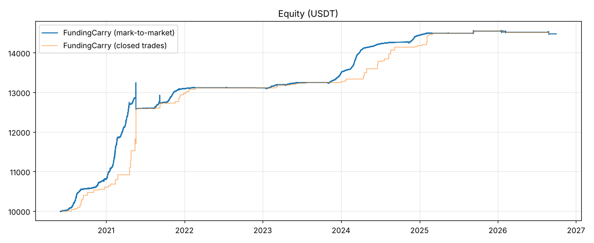

# 策略研究報告：多幣輪動資金費率套利（FundingCarry）

> 回測框架：Freqtrade 2026.9（回測、bias 檢查）＋ FreqUI（視覺化）
> 資料：Binance 官方歷史資料庫（data.binance.vision），2019-09 → 2026-09，現貨 1h/1d、USDT-M 永續 1h、標記價格 1h、資金費率
> 本報告所有數字皆可用 `bash scripts/reproduce.sh` 重現。

---

## 1. 結論

| 目標 | 結果（全期間 2020-06 → 2026-09，幣池 A） | 最嚴格的樣本外結果 | 判定 |
|---|---|---|---|
| 多幣池輪動 | 50 幣池每小時依資金費率排名，資金輪動到前 10 名 | — | ✅ |
| MDD < 15 % | 已平倉 0.5 %，逐時市值 2.6 % | 從未見過的幣池 B：5.1 % | ✅ |
| 勝率 > 60 % | 89.8 % | OOS 82.1 %，幣池 B 83.5 % | ✅ |
| 獲利曲線平滑 | 94 % 的月份為正，最差月 −0.3 % | 幣池 B：81 % 月份為正 | ✅ |
| 避免過擬合 | 參數高原、凍結後 OOS、未見幣池、Monte Carlo、手續費壓力、前視檢查 | 見第 4 節 | ✅ |

**誠實的限制**：年化約 5 %（幣池 B 約 6 %），且報酬高度依賴資金費率水位——2021 年 +20 %，
2025 年 +0.5 %、2026 年 1–9 月 0 %（資金費率長期低於門檻，策略空倉）。這是「低風險、低且不穩定的
報酬」策略，不是高報酬策略。詳見第 6 節。

---

## 2. 策略邏輯

### 2.1 核心概念

永續合約以「資金費率」讓價格貼近現貨：多頭擁擠時多方每 8 小時（2025 後部分幣種每 4 小時）付錢給空方。

> **現貨買 1 單位 ＋ 永續空 1 單位** → 價格漲跌互相抵銷，只收資金費率。

風險只剩「基差」（永續與現貨價差）的變動、交易所/下市風險，以及資金費率轉負。

### 2.2 規則（全部為事先決定的整數值，無最佳化）

| 項目 | 規則 |
|---|---|
| 訊號 | 標的永續過去 72 小時資金費率，換算為「每 8 小時平均費率」；只使用 K 線開盤前已公布的費率（保守延遲 1 小時） |
| 輪動 | 所有幣依訊號排名，只有前 `max_open_trades`（10）名可進場 |
| 進場 | 平均費率 ≥ 0.02 % / 8h（= Binance 基礎費率 0.01 % 的 2 倍，約年化 22 %） |
| 出場 | 72 小時累計費率 < 0（遲滯設計：進場門檻高、出場門檻低，避免來回洗單）；或永續停止支付費率（下市/遷移） |
| 停損 | −5 % 資本（約 10 % 不利基差），整個回測期間只觸發一次（FTM 遷移事件） |
| 部位 | 10 個槽位，每槽約 10 % 資本；1 倍對沖（現貨 1 + 永續保證金 1 → 每單位名目需 2 單位資本） |

### 2.3 在 Freqtrade 中的實作方式

Freqtrade 一筆交易只能有一條腿，因此先以 `scripts/build_carry_data.py` 為每個幣建立**合成套利標的**
`<COIN>CARRY/USDT`：其價格 = 該 1 倍對沖部位的逐時淨值

```
r_t = (r_spot,t − r_perp,t + funding_t) / 2
```

- 真實的現貨與永續價格（基差變動完整計入，包含 2022 LUNA、FTX，2025 FTM 遷移等事件）
- 真實資金費率；費率計入「收盤時間 = 支付時間」的 K 線——在支付時間之後才進場的部位拿不到該次費率
- 手續費：設定 0.1 % / 邊（資本計），相當於 4 條腿 × ~0.1 % 名目 + 滑價（Binance 實際：現貨 0.1 %、永續 taker 0.05 %）

接著 `FundingCarry` 像一般策略一樣在 Freqtrade 中排名、進出場、計算勝率與回撤，FreqUI 可直接載入結果。

---

## 3. 資料與回測設定

| 項目 | 設定 |
|---|---|
| 幣池 A（設計用） | 50 個主流幣，**包含之後下市/遷移的 EOS、FTM、MATIC、WAVES** 以降低倖存者偏差 |
| 幣池 B（holdout） | 另外 50 個幣（QNT、YFI、LDO、IMX、TIA、ORDI、LUNA(舊)、BTT …），在最終驗證前完全未使用；PEPE 永續僅有 1000PEPE 合約故排除 → 49 個 |
| In-sample | 2020-06-01 → 2023-12-31（含 2021 牛市、2022 熊市、2023 盤整） |
| Out-of-sample | 2024-01-01 → 2026-09-30 |
| 起始資金 | 10,000 USDT |
| 時框 | 1h |

---

## 4. 防過擬合流程

1. **先發想、再驗證**：用 `research/carry_lab.py` 在 in-sample 了解套利經濟學（每年每幣的資金費率分布、換手成本），
   找出結構性問題（每日重新排名的換手成本 > 收益）→ 以「遲滯」解決，而不是調參數。
2. **只用整數、可解釋的參數**：0.02 % = 2 × 交易所基礎費率；72h = 9 次資金費率結算；−5 % 停損。
3. **參數敏感度**（in-sample，逐一擾動）：所有變體都獲利且回撤極小 → 參數高原，非尖峰（第 5.4 節）。
4. **先凍結、後測試**：策略在 git commit `f432895` 凍結後才第一次執行 OOS 與幣池 B。
   （之後為了通過前視檢查做了「保守化」修正：費率延遲 1 小時，所有結果皆以修正後程式重新產生。）
5. **完全未見過的幣池 B**：同一套程式、同一組參數，在 49 個從未使用的幣上跑完整 6 年。
6. **Monte Carlo**：5,000 次重抽交易順序。
7. **手續費 ×2 壓力測試**。
8. **前視偏差檢查**：
   - Freqtrade `recursive-analysis`：無遞迴指標變異、無指標前視。
   - Freqtrade `lookahead-analysis` 對**跨幣排名**策略會誤報（它以「單一幣種白名單」重跑切片，
     排名從 50 選 2 變成 1 選 1）。因此另寫 `research/pit_check.py`：在 12 個隨機時間點把**全部幣種**
     的 K 線與資金費率截斷，重算指標與訊號並與完整資料比較 → **479 萬個數值 0 差異**。
     並以刻意植入未來資料的「Leaky」策略驗證此檢查確實能抓到前視（32 個差異 → FAIL）。
9. **回撤以逐時市值計算**：`research/analyze.py` 由交易清單與 K 線獨立重建每小時淨值，
   不受 Freqtrade 錢包在幣種下市後遺失本金的問題影響（見第 6 節）。

---

## 5. 結果

### 5.1 總表

| 測試 | 交易數 | 勝率 | 總報酬 | CAGR | MDD 已平倉 | MDD 逐時市值 | 正報酬月份 | 最差月份 |
|---|---|---|---|---|---|---|---|---|
| In-sample 2020-06→2023-12（A） | 87 | 90.8 % | +30.8 % | 7.8 % | 0.1 % | 2.6 % | 95.8 % | −0.0 % |
| **OOS** 2024-01→2026-09（A） | 28 | 82.1 % | +5.2 % | 1.8 % | 0.5 % | 1.3 % | 81.8 % | −0.3 % |
| **Holdout 幣池 B** 2020-06→2026-09 | 133 | 83.5 % | +44.8 % | 6.0 % | 1.0 % | 5.1 % | 81.0 % | −0.3 % |
| 全期間（A） | 108 | 89.8 % | +39.1 % | 5.3 % | 0.5 % | 2.6 % | 94.1 % | −0.3 % |
| 全期間（A），手續費 ×2 | 108 | 83.3 % | +36.2 % | 5.0 % | 0.5 % | 2.8 % | 91.2 % | −0.3 % |

### 5.2 逐年報酬（%）

| 年 | 2020* | 2021 | 2022 | 2023 | 2024 | 2025 | 2026* |
|---|---|---|---|---|---|---|---|
| 幣池 A | 5.0 | 20.1 | 1.9 | 1.0 | 6.5 | 0.5 | 0.0 |
| 幣池 B | 6.2 | 22.2 | 1.0 | 1.0 | 7.0 | 2.6 | −0.5 |

\* 2020 自 6 月起、2026 至 9 月底。沒有任何一年出現有意義的虧損，包含 2022 熊市（LUNA、3AC、FTX）。

### 5.3 Monte Carlo（全期間，5,000 次）

| | p5 / 中位數 / p95 | 機率 |
|---|---|---|
| MDD | 中位數 0.5 %、p99 1.0 % | P(MDD < 15 %) = 100 % |
| 總報酬 | 29.0 % / 38.8 % / 50.3 % | P(報酬 > 0) = 100 % |
| 勝率 | 85.2 % / 89.8 % / 94.4 % | P(勝率 > 60 %) = 100 % |

### 5.4 參數敏感度（in-sample，逐一擾動）

| 參數 | 值 | 交易數 | 勝率 | 總報酬 | MDD 逐時市值 | 正報酬月份 |
|---|---|---|---|---|---|---|
| enter_rate | 0.0001 | 245 | 60.4 % | +32.3 % | 2.8 % | 82.5 % |
| enter_rate | 0.00015 | 93 | 87.1 % | +30.4 % | 4.8 % | 92.3 % |
| enter_rate | 0.0002 ★ | 87 | 90.8 % | +30.8 % | 2.6 % | 95.8 % |
| enter_rate | 0.0003 | 75 | 92.0 % | +29.7 % | 3.7 % | 100.0 % |
| enter_rate | 0.0004 | 61 | 90.2 % | +28.8 % | 2.6 % | 100.0 % |
| lookback_h | 24 | 119 | 79.8 % | +31.3 % | 4.0 % | 100.0 % |
| lookback_h | 48 | 99 | 82.8 % | +30.9 % | 2.4 % | 100.0 % |
| lookback_h | 72 ★ | 87 | 90.8 % | +30.8 % | 2.6 % | 95.8 % |
| lookback_h | 120 | 69 | 88.4 % | +31.0 % | 5.0 % | 100.0 % |
| lookback_h | 168 | 61 | 90.2 % | +31.1 % | 4.3 % | 95.5 % |
| stoploss | -0.03 | 87 | 90.8 % | +30.8 % | 2.6 % | 95.8 % |
| stoploss | -0.05 ★ | 87 | 90.8 % | +30.8 % | 2.6 % | 95.8 % |
| stoploss | -0.08 | 87 | 90.8 % | +30.8 % | 2.6 % | 95.8 % |
| stoploss | -0.15 | 87 | 90.8 % | +30.8 % | 2.6 % | 95.8 % |
| max_open_trades | 5 | 44 | 88.6 % | +31.9 % | 2.6 % | 100.0 % |
| max_open_trades | 10 ★ | 87 | 90.8 % | +30.8 % | 2.6 % | 95.8 % |
| max_open_trades | 20 | 147 | 91.8 % | +29.4 % | 4.1 % | 100.0 % |

★ = 採用值。所有 17 個變體皆獲利（+28.8 % ~ +32.3 %），逐時市值 MDD 介於 2.4 % ~ 5.0 %；唯一接近目標邊界的是把進場門檻降到基礎費率 0.01 %（勝率 60.4 %，因為頻繁進出）。停損在 −3 % ~ −15 % 間結果完全相同（in-sample 從未觸發）。結論：績效不依賴任何單一參數值。

### 5.5 權益曲線

幣池 A 全期間（藍：逐時市值；橘：已平倉）


幣池 B（從未見過的幣）



---

## 6. 風險與限制（請務必閱讀）

1. **報酬會長期趨近 0**：資金費率是「槓桿多頭的擁擠程度」。2025-03 之後市場槓桿需求低，
   幾乎沒有幣達到 0.02 %/8h，策略多數時間空倉。平滑 ≠ 一定賺錢。
   可行的改善方向（**尚未驗證，不在本次結論內**）：空倉時資金放 USDT 理財/Earn；或在 OOS 之外的新資料上評估較低門檻。
2. **基差 / 下市 / 遷移風險**：2025-01 FTM → Sonic 遷移期間現貨與永續脫鉤，停損 −5.2 %；
   實盤應訂閱交易所下市公告並提前平倉。Freqtrade 的 `delisting` 檢查可協助。
3. **永續空單的清算風險**：1 倍對沖時，永續空單需在價格大漲時補保證金（現貨與合約在不同錢包）。
   建議使用統一帳戶 / 組合保證金，或設定自動補保證金；不要為了提高報酬而加槓桿。
4. **合成 K 線的盤中資訊**：`<COIN>CARRY` 只有逐時收盤，盤中瞬間基差尖峰不可見，因此停損以收盤近似。
5. **Freqtrade 錢包統計誤差**：當幣種資料在回測中途結束（FTM），Freqtrade 錢包與 `final_balance` / CAGR
   欄位會遺失該筆本金（交易本身仍正確平倉並計入總報酬）。本報告的 MDD 以獨立重建的逐時市值為準；
   FreqUI 中顯示的 CAGR 3.6 % 因此偏低（正確為 5.3 %）。
6. **交易所對手方風險**：資金全部放在單一交易所。
7. **實盤需兩條腿**：回測使用合成標的；實盤需同時執行「現貨多單」與「永續空單」（例如兩個 Freqtrade bot
   使用相同訊號、或自行撰寫下單層），並處理兩邊成交價差與再平衡。本專案未包含實盤下單程式。

---

## 7. 研究歷程（含失敗的策略）

為了透明，以下列出所有評估過的設計。**評估過的候選越多，選中「僥倖」結果的機率越高**，
因此每次失敗都換用新的、未使用過的驗證資料，並保留所有被淘汰的版本於 `research/archive/`。

| 版本 | 想法 | In-sample | 樣本外 | 結論 |
|---|---|---|---|---|
| v1 RotationPullback（1h 現貨） | BTC 趨勢濾網 + 動能前 10 + RSI/布林抄底 | 勝率 78 %、MDD **40 %** | — | 淘汰：小賺大賠 |
| 訊號實驗室 | 比較 6 種進場 × 5 種出場（`signal_lab.py`） | 發現：沒有趨勢濾網的抄底無優勢；4h 優於 1h | — | 用於發想 |
| v2 RotationDip 4h | 市場寬度濾網 + 4h 抄底 | 勝率 69 %、MDD 15.1 % | — | 淘汰：敏感度測試出現懸崖（動能 15 天 PF 0.99、45 天虧損） |
| v3 RotationDip 1h | 同邏輯 1h，敏感度呈高原 | 勝率 64 %、MDD 11.6 % | 2024–26：勝率 **46 %**、MDD 14–15 % | **OOS 失敗**：每小時更新的寬度濾網一個月翻轉約 10 次 |
| v4 RotationDip 1h | 日線寬度、崩盤出場、ROI 3 % | 勝率 70.5 %、MDD 7–10 % | 幣池 B：勝率 69 %、MDD **20 %**；2024–26：**−12.8 %** | **Holdout 失敗** |
| v5 RotationDipLS | 鏡像做空（期貨） | 勝率 65 %、MDD 20 % | — | 淘汰：空頭反彈軋空 |
| **FundingCarry** | Delta 中性資金費率套利 + 輪動 | 勝率 91 %、MDD 2.6 % | OOS 82 %/1.3 %；幣池 B 83.5 %/5.1 % | **採用** |

方向性策略失敗的根本原因（`research/` 中的資料分析）：2024–2026 年每年有 **84–85 % 的山寨幣跑輸 BTC**，
山寨幣中位數報酬 2024 +20 %、2025 −65 %、2026 −12 %。「買強勢山寨幣回檔」在 2020–2023 有效，
但市場結構改變後失效——這正是樣本外測試要抓的東西。套利策略不依賴價格方向，因此跨越不同市場結構仍穩定。

`RotationDip.py`（v4）保留在 `user_data/strategies/` 供研究比較，**不建議實盤**。

---

## 8. 重現

```bash
bash scripts/reproduce.sh                 # 完整（含下載資料）
SKIP_DOWNLOAD=1 bash scripts/reproduce.sh # 已有資料時
```

結果輸出於 `research/results/`；`carry_full.zip` 可直接在 FreqUI 的 Backtest → Load Results 載入。
